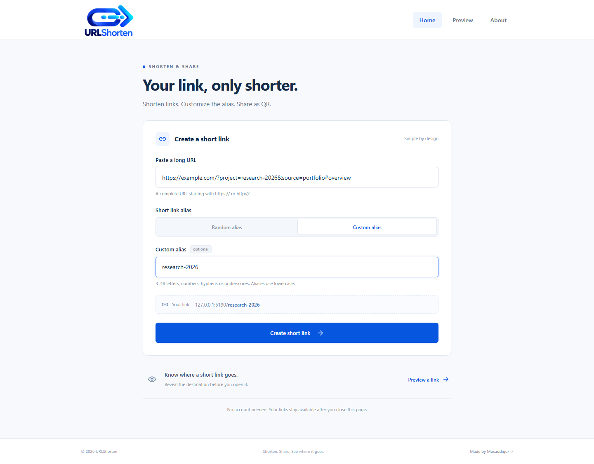
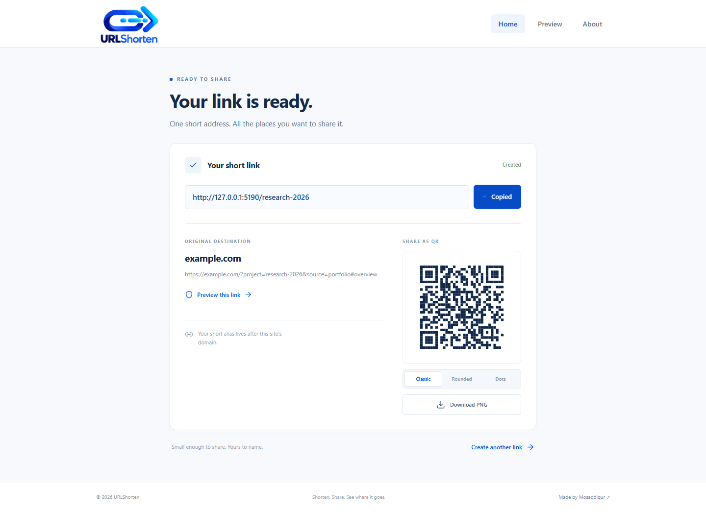
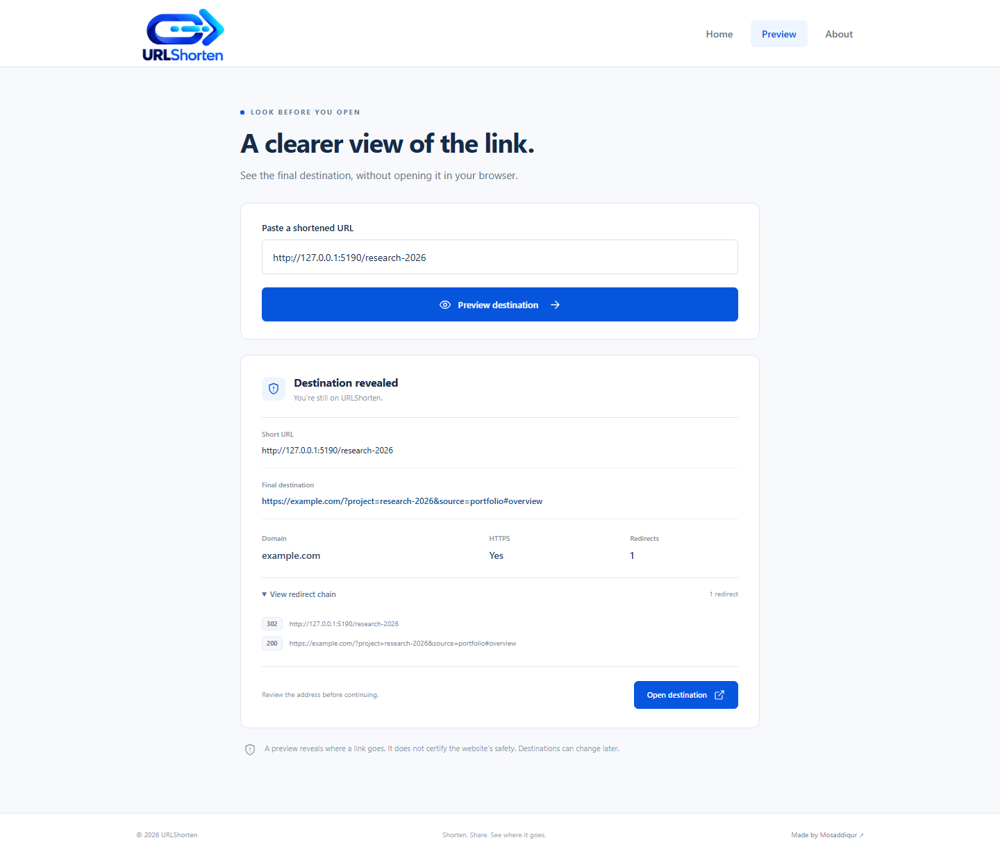

<p align="center">
  
</p>

# URLShorten

Shorten links. Customize the alias. Share as QR. Preview a shortened URL before opening it.

<p align="center">
  <a href="LIVE_DEMO_URL"></a>
</p>

## Overview

URLShorten is a small public link utility. The homepage is the creation workflow;
the only other pages are **Preview** and **About**. There are no accounts,
dashboards, analytics, tracking cookies or background jobs.

## Features

- Create a persistent short link with a compact random alias by default.
- Choose a custom alias after the site's configured domain.
- Generate Classic, Rounded or Dots QR codes and download the selected style as a PNG.
- Reveal a link's final destination, domain, HTTPS use and HTTP redirect chain.
  Opening the destination is always a separate, explicit action.

## Screenshots

These are fresh captures of the actual application running locally. The address
shown is the local test server, not a deployed production site.

| Create                             | Result                                              | Preview                                              |
| ---------------------------------- | --------------------------------------------------- | ---------------------------------------------------- |
|  |  |  |

## Core workflow

1. The browser sends the long URL and optional alias to `POST /api/links`.
2. The function validates the URL and its resolved addresses.
3. It atomically reserves the alias and stores the destination on the server.
4. The browser shows the short URL and creates a QR code locally.
5. A later `GET /alias` retrieves the mapping, revalidates the destination and
   returns an HTTP **302** redirect.

The query string and fragment of the original URL are preserved. Parameters
added to the short URL are not forwarded to the destination. The mapping is
independent of the creator's browser and has no automatic expiry.

## Custom aliases

Aliases use **3–48 characters**: letters, numbers, hyphens and underscores,
starting with a letter or number. Leading and trailing spaces are trimmed;
letters are normalized to lowercase. Examples: `mos`, `portfolio`,
`github`, `research-2026`.

Slashes, percent encodings, query characters, invisible characters and application
routes such as `api`, `about`, `preview`, `create`, `admin` and `assets`
are rejected. A duplicate returns **409** with “This custom link is already taken.”
Existing mappings are never silently overwritten, including concurrent requests.

The form starts with **Random alias** selected: paste a URL and create the link.
Choose **Custom alias** to enter your own name instead. Switching back to random
ignores that custom name, and creating another link restores the random default.

Automatic aliases are **7-character** names made with Node's cryptographic
`randomInt`. Random collisions are retried, with a bounded number of attempts.

If the site is configured as `urlshorten.netlify.app`, an alias like `portfolio`
produces `https://urlshorten.netlify.app/portfolio`. The application uses the
current site origin; it cannot create arbitrary domains. A custom domain must be
owned and configured in Netlify before links can use it.

## QR codes

The existing `qrcode` matrix engine supplies error correction level H.
Three conservative styles keep finder, timing and alignment patterns unchanged:

- **Classic:** square modules.
- **Rounded:** softly rounded data modules.
- **Dots:** circular data modules.

Codes have a white background, dark foreground and at least a four-module quiet
zone. PNG exports are **1024 × 1024** and render the selected style. Nothing is
uploaded to a third-party QR service.

Automated tests rasterize and decode every style at 220, 512 and 1024 pixels.
Browser tests also decode the actual PNG downloads with `jsQR` and compare their
contents with the exact short URL.

## Safe preview

`POST /api/preview` resolves own-site mappings from storage and follows external
HTTP redirects on the server. It returns the short URL, final destination,
domain, final HTTPS state, redirect count and ordered chain. It never redirects
the browser.

External links are supported when the service permits automated HEAD or GET
requests. Preview does not execute JavaScript, follow HTML meta refresh, sign in,
collect page content or manufacture a malware score.

## Architecture

```text
Browser → Vite / React static frontend
        → 3 Netlify Functions
             create-link  /api/links
             preview-link /api/preview
             redirect-link /:alias
        → Netlify Blobs (persistent key/value mappings)
```

Production uses a site-wide, strongly consistent
[Netlify Blobs store](https://docs.netlify.com/build/data-and-storage/netlify-blobs/).
Each alias is the key for a small JSON record:

```json
{
  "version": 1,
  "alias": "portfolio",
  "destination": "https://example.com/page",
  "createdAt": "2026-10-04T00:00:00.000Z"
}
```

The adapter uses `onlyIfNew: true`, so alias reservation is atomic. Production
mappings use `urlshorten-links`; nonproduction deploys use
`urlshorten-links-previews` and cannot overwrite production mappings. Site-wide
storage survives application redeploys. Deploy previews share their separate
preview namespace.

Local `npm run dev` uses a small file adapter under ignored `.data/links`.
Publishing a completed file via an exclusive hard link prevents concurrent
writers from overwriting a mapping. Deployed functions always use Blobs; there is
no filesystem or in-memory fallback in production.

The project has no database server, Prisma, Redis, worker, scheduler or queue.

## Security controls

- Accept only complete HTTP/HTTPS URLs without embedded credentials or controls.
- Allow outbound website ports 80 and 443 only.
- Block localhost and internal hostname suffixes before DNS resolution.
- Resolve all available addresses through the system resolver and reject the
  entire result if any address is private, loopback, link-local, metadata,
  multicast, reserved, documentation-only or otherwise nonpublic.
- Pin the HTTP connection to a validated IP. DNS cannot be resolved a second
  time by the HTTP client, preventing rebinding between check and connection.
- Revalidate each redirect, including protocol changes and relative Locations.
- Require normal TLS trust and hostname validation.
- Limit DNS resolution to 2 seconds, each HTTP request to 3 seconds and the
  entire preview to 10 seconds and 6 redirects.
- Cap response headers at 16 KiB. HEAD is preferred; a 405/501 response receives
  a GET fallback with a 64 KiB Range. The connection closes immediately after
  headers; no response body is buffered or decompressed.
- Send no cookies, credentials or incoming request headers to external sites.
- Bound JSON input to 8 KiB, require JSON and reject cross-origin browser POSTs.
- Apply Netlify's function rate limits: 20 creations and 30 previews per minute
  per client IP/domain. These platform limits are not simulated by the Vite server.
- Recheck destinations before redirects, use `Cache-Control: no-store`, and
  return friendly errors without internal identifiers or stack traces.
- Ship CSP, frame, content-type, permissions and referrer headers in `netlify.toml`.

These are network controls, not evidence that a destination is harmless.

## Deployment

Use **Netlify's Git integration or Netlify CLI deployment** so both the static
build and functions are published. A manual drag-and-drop of `dist` alone is
insufficient for persistent links.

1. Publish this repository to your own GitHub account.
2. Import it in Netlify with Node 24.
3. Build command: `npm run build`; publish directory: `dist`;
   functions directory: `netlify/functions`. All are in `netlify.toml`.
4. Configure the site's Netlify subdomain or a domain you own.
5. Verify creation, redirect and preview on the deployed domain.

## Configuration

There are **no required user-provided secrets**. Netlify supplies Blobs access
inside deployed functions. Do not paste a Netlify personal access token into
frontend code, a VITE variable or the repository.

| Optional setting        | Purpose                                                                                                                                |
| ----------------------- | -------------------------------------------------------------------------------------------------------------------------------------- |
| `URLSHORTEN_STORE_NAME` | Override the store name, set in Netlify's Functions environment scope. Use different values for production and previews if overriding. |
| `URLSHORTEN_DATA_DIR`   | Change the local Vite file-store directory; not used by deployed functions.                                                            |

The API generates short URLs from the incoming request origin, including HTTPS.
The frontend displays that returned URL and encodes the same URL in its QR codes.
There is no hardcoded public domain or secret in the frontend.

Function paths take precedence over the SPA fallback. The redirect function
excludes `/preview` and `/about`; `/* → /index.html` lets direct refreshes of
those pages work. Static assets are served normally.

See [deployment details](docs/DEPLOYMENT.md).

The supported deployment serves the frontend and functions on the same origin.
For separately hosted components, the frontend host must proxy `/api/*` and
`/:alias` to the functions while preserving the public HTTPS request URL.
Direct cross-origin API calls are deliberately blocked; there is no separate
frontend API-base setting. A static-only host cannot serve working short links.

Keep the same Netlify site and store name when redeploying. Moving to a new site
or changing `URLSHORTEN_STORE_NAME` does not migrate existing mappings. Export
and import the store before such a move.

## Local setup

Requires **Node.js 22.12+**; Node 24 is recommended.

```bash
npm ci
npm run dev
```

Open [http://127.0.0.1:5173](http://127.0.0.1:5173). One process serves the
frontend and local function handlers. No .env, account or database setup is needed.
Local mappings survive server restarts but are not uploaded to production.

To use Netlify's local functions and Blobs emulator instead:

```bash
npm run dev:netlify
```

This builds the frontend, then uses `netlify dev` on port 8888. Vite's preview
server supplies compiled assets through Netlify's proxy with the production
security headers. Restart it after frontend edits; use `npm run dev` for hot reload.
The CLI may ask you to link a site for account-specific operations;
local build verification can use `npx netlify-cli build --offline`.

`npm run preview` is a static frontend preview. Use `npm run dev` or
`netlify dev` for creation and preview APIs.

## Testing

```bash
npm run typecheck
npm run lint
npm run format
npm test
npx playwright install chromium
npm run test:e2e
npm run build
npm run check:publication
```

`npm run release:check` runs the complete local gate. Browser tests require
public DNS and internet connectivity for destination checks; unit, storage and
SSRF tests use deterministic fixtures and never permit private-address fetching.
E2E data is isolated in ignored `.data/e2e`. The setup resets only that directory.

The suites cover aliases, duplicate races, persistence, create/redirect/preview,
stored-URL validation, private and encoded address forms, mixed DNS answers,
pinned requests, timeouts, HTTP chains, real PNG decoding, clipboard copy,
independent visitors, desktop/mobile layout and page refreshes.
GitHub Actions runs the same gates and a dependency audit.

## Limitations

- Short links are public and permanent until an operator removes their mapping.
  They are not secret storage. Do not shorten private URLs or access tokens.
- There is no account, owner recovery, edit/delete UI or automatic expiry.
- A preview is a point-in-time HTTP destination view. Sites can change later,
  block automation, vary by visitor or require JavaScript/authentication.
- Private/internal destinations, nonstandard ports and invalid TLS certificates
  are intentionally refused. DNS failures produce a friendly error.
- Netlify availability and plan quotas apply. The owner must manage abuse and
  remove unwanted mappings through the Blobs UI; the public app has no admin panel.
- Publishing still requires your GitHub/Netlify accounts and a configured domain.
  No live deployment is created by the local build.

## License

[MIT](LICENSE).

## Author

Designed and built by **[Mosaddiqur Rahman ↗](https://www.linkedin.com/in/mosaddiqur/)**.
